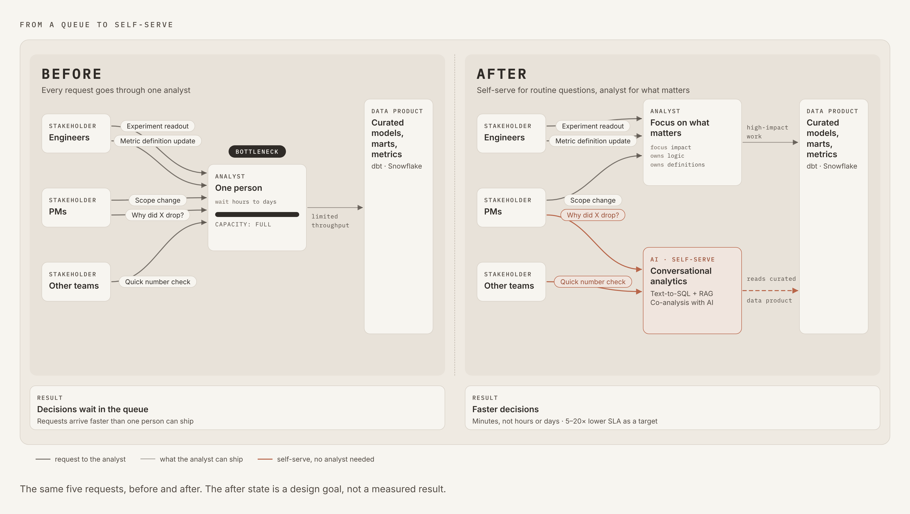
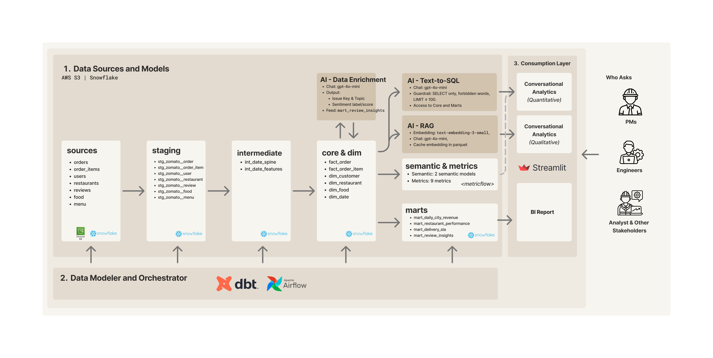

# Zomato dbt models

This dbt project turns Zomato source tables in Snowflake into reusable facts, dimensions, reporting marts, and metric definitions. It is the modeling layer of the [Zomato AI Analytics Pipeline](https://github.com/achmadrozie/zomato-ai-analytics-pipeline).

## Why this modeling layer matters

The project aims to move routine analytics questions from an analyst queue toward self-service answers backed by curated data. The before/after diagram shows that goal; its faster decision time is a target, not a measured result.



The dbt models, marts, and metric definitions below form the curated data product that both analysts and the conversational apps can use.

## Architecture



The dbt path in the diagram runs from **staging → intermediate → core → marts**. Semantic models and metrics define business meaning on top of the core facts. The diagram shows the original AI model labels; the current text-to-SQL app uses `gpt-6-luna`.

## Model layers

| Layer | Materialization | What lives here |
| --- | --- | --- |
| [`staging`](models/staging/zomato/) | Views | Standardized orders, order items, users, restaurants, reviews, food, and menu records from Snowflake sources. |
| [`intermediate`](models/intermediate/date/) | Views | Date spine and derived date features used downstream. |
| [`core`](models/core/) | Tables | `fact_order`, `fact_order_item`, and customer, restaurant, food, and date dimensions. |
| [`marts`](models/marts/) | Tables | Daily city revenue, restaurant performance, delivery SLA, and review insights. |

The `fact_order` grain is **one row per order**; `fact_order_item` is **one row per item**. Keep that distinction when aggregating order and item metrics. The [schema-name macro](macros/generate_schema_name.sql) places models in their configured `STAGING`, `INTERMEDIATE`, `CORE`, and `MARTS` schemas instead of appending the schema name to the profile's default schema.

## Semantic models and metrics

The [`semantic_models`](models/semantic_models/) directory defines semantic models for the order and order-item facts, plus a MetricFlow time spine. The [`metrics`](models/metrics/) directory defines nine metrics, including order counts, GMV, AOV, cancellation rate, item count, ordered quantity, and ordered amount. Their YAML files are the source for exact business definitions.

The [text-to-SQL app](../ai/03_text_to_sql.py) reads the semantic model and metric YAML files at runtime to inform SQL generation. It then executes the generated `SELECT` directly in Snowflake; it does **not** query MetricFlow. This screenshot shows one downstream result:


## Build locally

1. Prepare the Snowflake source tables using the scripts in [`../snowflake/`](../snowflake/).
2. Configure a local dbt profile named `dbt_zomato` with a Snowflake target. The profile and credentials stay outside this repository.
3. From this directory, run:

   ```bash
   dbt debug
   dbt build --exclude tag:ai
   ```

4. Once the review enrichment output exists in Snowflake, build the AI review mart with `dbt build --select tag:ai`.

The [`zomato_batch` Airflow DAG](../airflow/dags/zomato_batch.py) runs the regular dbt build, review enrichment, and AI mart build in sequence. See the [repository README](https://github.com/achmadrozie/zomato-ai-analytics-pipeline) for the full pipeline and app setup.
